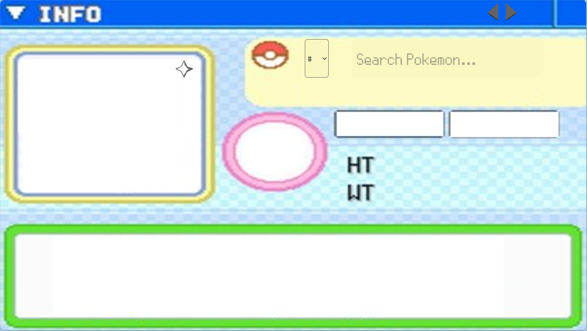

# Pokedex App

## Project Description

A pokedex app that will display information about a specific pokemon when inputted by the user. App currently displays information for all pokemon up to the end of Generation 4 and uses sprites from Pokemon Platinum. 

## Usage
Using Java 21, Spring 3.2.0 and Maven 3.9.11
* Run App.java
* Run npm run start inside the /frontend directory

## License
The FontStruction “Pokémon DP Pro” (https://www.fontstruct.com/fontstructions/show/404271) by “crystalwalrein” is licensed under a Creative Commons Attribution Share Alike license (http://creativecommons.org/licenses/by-sa/3.0/).